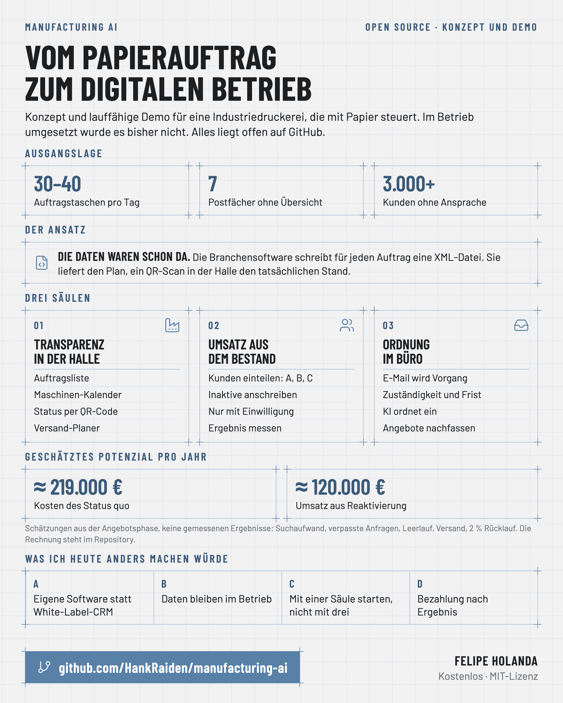
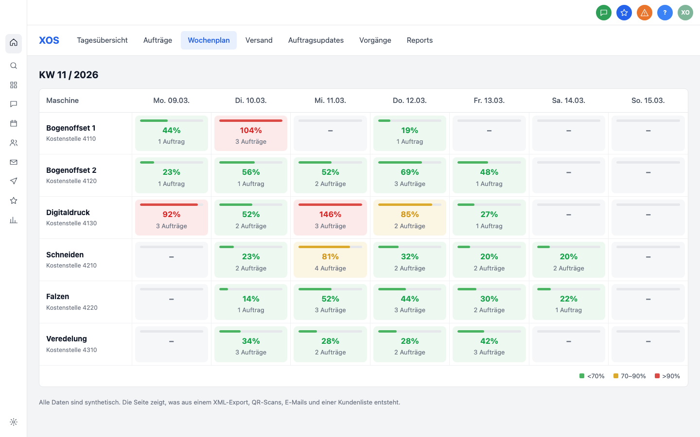

# Manufacturing AI

Ein digitales Betriebssystem für Fertigungsbetriebe, die noch mit Papier steuern. Entstanden als Konzept und lauffähige Demo für eine mittelständische Industriedruckerei und hier offen dokumentiert, mit Datenmodell, Vorlagen und Beispielcode.



## Das Problem

- Jeden Tag laufen 30 bis 40 Auftragstaschen aus Papier durch die Halle. Ruft ein Kunde an, geht jemand suchen.
- Sieben Mitarbeitende im Büro arbeiten in sieben getrennten Postfächern. Angebote werden selten nachgefasst.
- Über 3.000 Bestandskunden liegen in der Datenbank. Niemand spricht sie an.

## Die Idee

Die Daten waren schon da. Die Branchensoftware schreibt für jeden Auftrag eine XML-Datei mit Terminen, Arbeitsgängen und geplanten Zeiten. Nur hat sie niemand gelesen. Darauf bauen drei Säulen auf:

| Säule | Was sie löst | Bausteine |
|---|---|---|
| 1. Transparenz in der Halle | Wo steht der Auftrag, wie voll sind die Maschinen? | Auftragsliste, Maschinen-Kalender, Status per QR-Code, Versand-Planer |
| 2. Umsatz aus dem Bestand | Welche Kunden haben lange nichts bestellt? | Kunden einteilen, inaktive anschreiben, Ergebnis messen |
| 3. Ordnung im Büro | Welche Anfrage liegt bei wem, und seit wann? | Jede E-Mail wird ein Vorgang mit Frist, Angebote werden nachgefasst |

## Ausprobieren

Python 3.9 oder neuer genügt. Es werden keine weiteren Pakete gebraucht.

```bash
git clone https://github.com/HankRaiden/manufacturing-ai.git
cd manufacturing-ai
python3 -m xos demo      # rechnet die Beispieldaten durch und schreibt out/dashboard.html
python3 -m xos roi       # Kosten des Status quo mit Beispielannahmen
python3 -m unittest discover -s tests
```

Danach `out/dashboard.html` im Browser öffnen. Die Seite ist wie die ursprüngliche Demo aufgebaut, mit Reitern für Tagesübersicht, Aufträge, Wochenplan, Versand, Auftragsupdates, Vorgänge und Reports. Alle Daten in `data/sample` sind frei erfunden.



## Was hier liegt

| Ordner | Inhalt |
|---|---|
| [`docs/`](docs) | Ausgangslage, Konzept, Architektur, Datenmodell, Kennzahlen, Sprints, Lehren, Übertragbarkeit, Datenschutz |
| [`xos/`](xos) | Beispielcode in Python, ein kleines Modul pro Baustein |
| [`templates/`](templates) | Fragen für die Bestandsaufnahme, Leistungsverzeichnis, Feldliste, Fahrplan, E-Mails für die Reaktivierung |
| [`prompts/`](prompts) | Prompt, mit dem ein Sprachmodell E-Mails einordnet |
| [`data/sample/`](data/sample) | Erfundene Aufträge, E-Mails, Angebote, Kunden und Scans |

## Was es bringen kann

Meine Schätzung aus der Angebotsphase: Suchen, verpasste Anfragen, Maschinen-Leerlauf und ungebündelter Versand kosten einen Betrieb dieser Größe rund 219.000 € im Jahr. Die Reaktivierung der Bestandskunden hat ein Potenzial von rund 120.000 € Umsatz.

Das sind Rechnungen mit Annahmen, keine gemessenen Ergebnisse. Die Rechnung steht offen in [`docs/05-kennzahlen-und-ersparnis.md`](docs/05-kennzahlen-und-ersparnis.md), damit jeder die eigenen Zahlen einsetzen kann.

## Was ich heute anders machen würde

- Eigene, kleine Software statt White-Label-CRM.
- Die Daten bleiben beim Auftraggeber.
- Mit einer Säule starten, nicht mit drei. Welche, entscheidet der Betrieb.
- Bezahlung nach Ergebnis.

Die Begründung steht in [`docs/07-lessons-learned.md`](docs/07-lessons-learned.md).

## Für wen das noch passt

Für jeden Betrieb mit Auftragsfertigung und Laufzetteln: Verpackung, Werbetechnik, Lohnfertigung in Metall und Kunststoff, Schreinereien, Oberflächentechnik. Mehr in [`docs/08-uebertragbarkeit.md`](docs/08-uebertragbarkeit.md).

## Einordnung

- **Stand:** Konzept, Angebot und eine lauffähige Demo. Im Betrieb umgesetzt wurde es bisher nicht. Es gibt deshalb keine gemessenen Ergebnisse.
- Die Demo wurde auf einem White-Label-CRM (GoHighLevel) gebaut. Der Code hier ist neu geschrieben, unabhängig von jeder Plattform und nicht der Code der Demo.
- Es sind keine Kundendaten, Namen, Preise oder Zugangsdaten enthalten.

## Feedback

Ich stelle meine KI-Projekte der letzten Jahre nach und nach offen zur Verfügung und verkaufe nichts. Wenn du etwas davon umsetzt, schreib mir, wie es gelaufen ist: als [Issue](https://github.com/HankRaiden/manufacturing-ai/issues) oder auf LinkedIn.

## Lizenz

[MIT](LICENSE)
