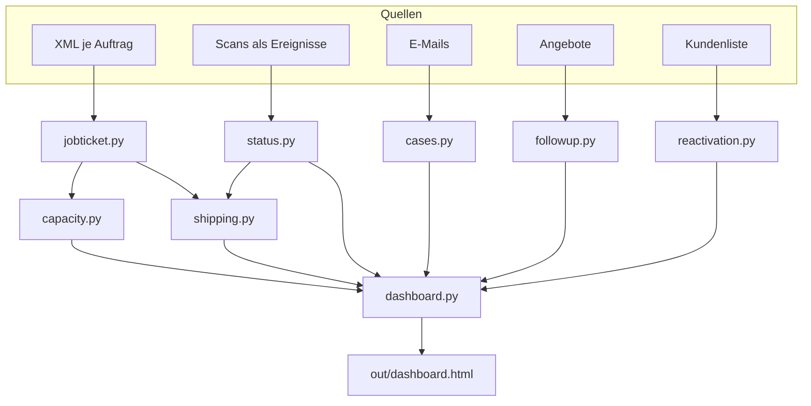

# 3. Architektur

## Aufbau der Demo

Stand vorweg: Das Projekt ist bis zu Angebot und Demo gekommen, nicht bis in den Betrieb. In der Demo waren die Maschinendaten aus dem Export ausgewertet und die Übersichten liefen. Noch nicht gebaut waren die beiden Automatismen, die das Ganze im Alltag tragen: das laufende Einlesen der XML-Dateien und die Umwandlung eingehender E-Mails in Vorgänge. Beides war fertig geplant.

Die Demo wurde auf einem White-Label-CRM gebaut (GoHighLevel). Der Gedanke dahinter: Kontakte, Postfächer, Automatisierungen, Kalender und Rechteverwaltung sind dort schon vorhanden. Man baut nur das dazu, was fehlt.

| Schicht | Umsetzung in Demo und Konzept |
|---|---|
| Datenhaltung | CRM mit eigenen Datenobjekten (Custom Objects) für Vorgänge und Produktionsaufträge |
| Oberfläche | Eigene Seiten (Custom Pages) für Übersicht, Auftragsliste, Maschinen-Kalender, Versand und Auswertungen, eingebettet in die Navigation des CRM |
| Datenquelle Produktion | XML-Export der Branchensoftware aus einem überwachten Ordner |
| Status aus der Halle | QR-Code auf der Auftragstasche, mobile Seite mit drei Knöpfen |
| E-Mail | Weiterleitung der Postfächer in das CRM, Automatisierung mit KI-Schritt für die Einordnung |
| Versand | Kartenansicht und Routenplanung mit Google Maps |
| Kampagnen | Listen und Abläufe des CRM für die Reaktivierung |

Ein paar Erkenntnisse aus der Konzeption, die anderen Zeit sparen:

- **Vorgänge als eigenes Objekt.** Ein Kunde kann gleichzeitig eine Reklamation, eine Preisanfrage und eine Datenlieferung offen haben. Das gehört nicht ins Notizfeld des Kontakts.
- **Felder in drei Gruppen.** Steuerung (Status, Priorität, Zuständigkeit, Art, Frist), Produktionsdaten (Auftragsnummer, Wunschtermin, Kategorie, Anhang) und Inhalt (Zusammenfassung, Stimmung, Originaltext). Oben steht, was man zum Entscheiden braucht.
- **Mehrere Anhänge** sind in CRM-Automatisierungen oft ein Problem. Große Dateien gehören in eine Dateiablage, am Vorgang steht nur der Link.
- **Text ja, Anhang nein.** Die eingebaute KI des CRM kann nach meiner Prüfung den Text einer E-Mail lesen, den Inhalt eines PDF im Anhang aber nicht. Dafür braucht es einen zusätzlichen Schritt mit einem Modell, das Dokumente lesen kann.
- **Abfrage im Takt reicht.** Für den Maschinen-Kalender genügt es, den Ordner alle 15 Minuten zu lesen. Echtzeit klingt gut und ist hier unnötig.

## Die Referenz-Implementierung in diesem Repository

Der Code hier bildet dieselbe Logik ohne Plattform ab. Jedes Modul ist klein, hat keine Abhängigkeiten und lässt sich einzeln lesen.

| Modul | Aufgabe | Eingabe | Ausgabe |
|---|---|---|---|
| `jobticket.py` | Aufträge lesen | Ordner mit XML-Dateien | Aufträge mit Arbeitsgängen |
| `capacity.py` | Auslastung berechnen | Aufträge, Kapazität je Kostenstelle | Wochenkalender mit Ampel |
| `status.py` | Scans verarbeiten | Ereignisprotokoll | aktueller Status je Auftrag |
| `shipping.py` | Touren bilden | fertige Aufträge | Stopps je Region, Link zu Google Maps |
| `cases.py` | E-Mails einordnen | Absender, Betreff, Text | Vorgang mit 13 Feldern |
| `followup.py` | Angebote nachfassen | Angebotsliste | fällige Erinnerungen |
| `reactivation.py` | Kunden auswählen | Kundenliste | Segmente und Potenzial |
| `roi.py` | Status quo beziffern | Annahmen | Kosten pro Jahr |
| `dashboard.py` | alles zusammenführen | alle oben | JSON und eine HTML-Seite |

## An das eigene System anpassen

1. **Export prüfen.** Kann die eigene Branchensoftware pro Auftrag eine Datei schreiben (XML, CSV, JDF)? Fast alle können das.
2. **Felder zuordnen.** In `xos/jobticket.py` steht oben `FIELD_MAP`. Dort werden die Namen des eigenen Exports eingetragen. Termine als fortlaufende Tageszahl werden automatisch erkannt.
3. **Kostenstellen festlegen.** Welche sind Leitmaschinen und gehören in den Kalender? Welche Kapazität haben sie pro Tag?
4. **Status festlegen.** Die sechs Stufen in `xos/status.py` passen für die meisten Betriebe. Weniger ist besser.
5. **Postfächer anbinden.** Für den Anfang reicht eine Weiterleitung der Sammeladressen.

## Robustheit

Drei Stellen, an denen ein solches System im Alltag bricht, sind im Code berücksichtigt:

- Eine defekte XML-Datei stoppt den Lauf nicht. `read_folder()` gibt sie mit Dateiname und Grund zurück.
- Ein unmöglicher Scan, etwa "Versendet" vor "In Produktion", wird nicht still übernommen. Er landet bei `replay()` in einer Liste zur Klärung.
- Was die KI liefert, wird geprüft. Eine Auftragsnummer wird nur übernommen, wenn sie wörtlich in der E-Mail steht.
